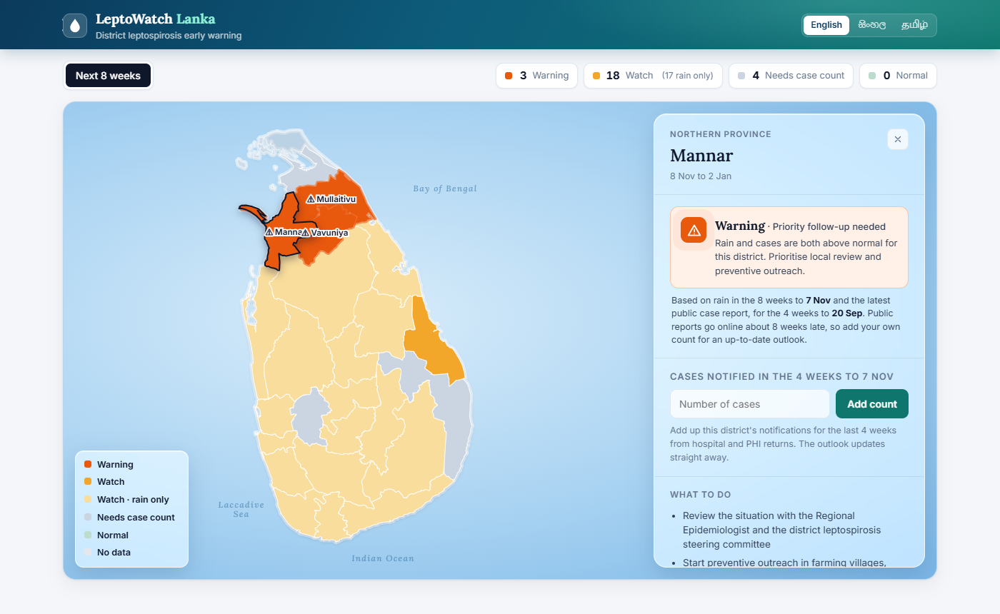
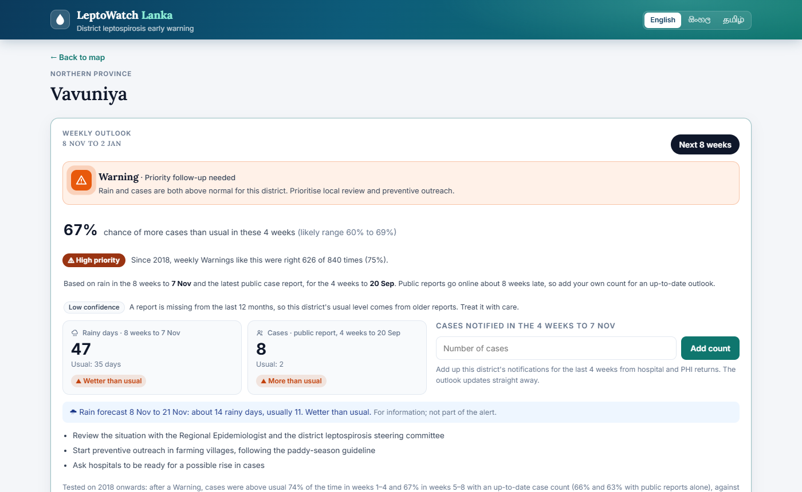
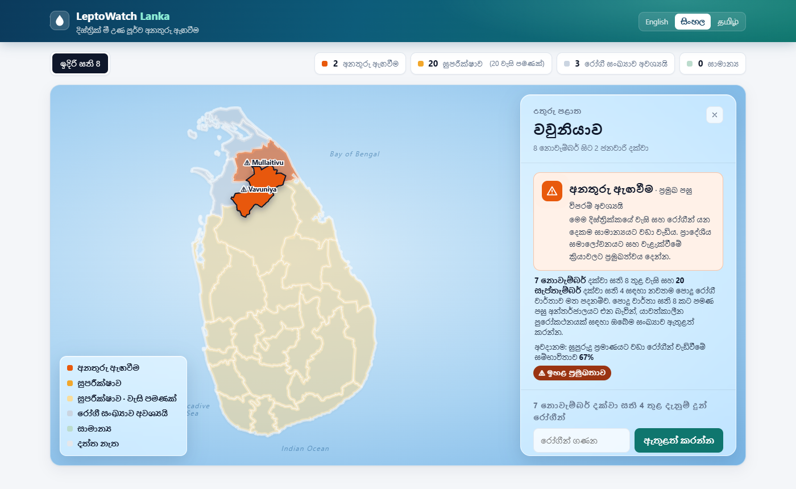

# LeptoWatch Lanka

**Live demo:** https://gitchamath.github.io/leptowatch-lanka/ (nothing to install; case counts typed there stay in
your browser and are not saved).

A district-level leptospirosis early warning for Sri Lanka. Every Saturday it combines rain over the last
8 weeks with cases over the last 4 weeks, and gives a district health officer one alert for the next 8 weeks:
how likely they are to be **worse than a normal season** for that district. The alert is scored separately
against weeks 1–4 and weeks 5–8.

- **Warning**: wetter than usual and cases clearly above usual (over 1.4 × usual). **Watch**: one of the two.
  **Normal**: neither. **Needs case count**: wetter than usual but no recent case count, so the officer is asked
  to enter one.
- On 2018 onwards, held out while the rules were chosen on 2011–2017, a Warning was followed by more cases than
  usual **74%** of the time in weeks 1 to 4 and **67%** in weeks 5 to 8 when the officer entered an
  up-to-date count, and **66%** and **63%** using public reports alone, which go online about 8 weeks late.
  By chance it would be 56%. Details under [How good it is](#how-good-it-is).
- **A real outbreak, replayed.** In December 2024 leptospirosis killed at least five people in Jaffna after the
  monsoon floods. Replayed on only the data available each Saturday, with the officer's own counts, Jaffna was on
  Warning from 2 November, about six weeks before cases peaked ([case study](research/case_jaffna_2024.md)).
- **Tested before trusted.** Every rule and every new idea was written down before its test
  (`research/PREREG_*.md`); the ideas that failed are reported too, and so is a data-cleaning bug we found and fixed.
- The dashboard is in English, Sinhala and Tamil. It also keeps the earlier monthly outlook ("Past seasons").



| District report | Same map in Sinhala |
|---|---|
|  |  |

*Outlook decided 7 November 2026. Without officer counts it uses the latest public report (4 weeks to 20 September).*

Population-level risk for planning prevention only. It does not diagnose, treat or advise individuals.

## Quick start

Needs Python 3.12 (tested on 3.12.10). Node 20+ is only needed to change the UI.

```
pip install -r requirements.txt
python scripts/seed.py          # load the snapshot in data/seed into data/leptowatch.sqlite and data/weekly.sqlite
python scripts/compare_models.py  # optional: method and baseline comparison shown on "How it works"
python scripts/build_state.py   # compute alerts, risk model, history and track record
python scripts/serve.py         # dashboard at http://127.0.0.1:8000
```

`python scripts/update.py` fetches new rainfall and case reports, then rebuilds alerts.
For the weekly outlook, `python -c "from lw import openmeteo; openmeteo.collect()"` fetches rain up to today and
`python scripts/build_weekly.py` rebuilds it. `.github/workflows/update.yml` runs all of this every Sunday and
commits the refreshed snapshot.
`python -m unittest discover -s tests` runs the tests.
`python scripts/export_static.py site` writes a static copy of the dashboard (every API answer as a JSON file; an
officer's weekly count is applied in the browser with the same rule, using the normal the server pre-computed, and
not saved). `.github/workflows/pages.yml` publishes it to GitHub Pages on every push and after each weekly update.

The dashboard is a React app (Vite + Framer Motion) in `frontend/`. The built files are committed in `web/`,
so Node is only needed to change the UI:

```
cd frontend
npm install
npm run dev      # hot-reload UI on :5173, API proxied to the Python server on :8000
npm run build    # writes the production build to ../web
```

## How it decides

For a target month, using only data up to one or two months earlier:

| Signal | Rule |
|---|---|
| Rain | rainy days (≥ 1 mm, district average) above that district's median for the same calendar month |
| Cases | cases above the district's normal for that month (seasonal pattern × trailing 12-month level) |
| **Warning** | both signals |
| Watch | one signal |

A month counts as "worse than normal" when its cases exceed the district's normal for that month.

The normal uses only complete months. The trailing level needs at least 6 of the last 12 months, and the
seasonal factor is the median ratio over at least five past years. With fewer than 9 complete months, or
when the latest public reports are old, the outlook is marked **low confidence**.

**Risk percentage.** `lw/ml.py` fits a logistic regression on the same signals, trained on 2011–2017 only.
It is published only if it passes a calibration check fixed in advance: on 2018+ its Brier score must beat
always predicting the 2011–2017 base rate, and every 10-point band with at least 30 months must be within
10 points of what happened. Live outlooks use that exact checked model. A likely range comes from refits on
resampled years. The report flags "signals disagree" when the rule and the model point different ways
(thresholds from 2011–2017).

## How good it is

Rules were fixed on 2011–2017 data and scored once on 2018 onwards (all 25 districts pooled).
These numbers are recomputed by `scripts/build_state.py` (stored under `pooled` in `data/state.json`).
The dashboard shows each district's own record in its card and replays any past month under "Past seasons".

| Held-out 2018+ | 1-month lead | 2-month lead |
|---|---|---|
| Months worse than normal anyway | 53% | 54% |
| **Warning** right when it fires | **71%** (465 of 653) | **65%** (422 of 645) |
| Rain signal alone | 58% | 58% |
| Case signal alone | 67% | 62% |

What this means:

- The Warning (rain and cases together) is the useful signal: 1.34× the base rate one month ahead, 1.22× two months ahead.
- Rain alone is only a few points better than chance, so it is shown as a Watch.
- The rain signal was stronger in 2011–2017 (lift 1.28 at two months) than since 2018 (1.07).
  The one-month Warning held up (69% → 71%); the two-month Warning weakened (71% → 65%). Both periods are reported.

**Risk percentage.** One month ahead it passed its calibration check (Brier 0.219 vs 0.251 for the base rate,
AUC 0.70). Two months ahead it failed, also after recalibration, so no percentage is shown there. Months without
a case count were not well calibrated (predicted 62%, observed 55%), so the percentage is shown only when the
month's count is known.

**High-priority Warning.** A Warning whose one-month percentage is in the top 10% of 2011–2017 months (at least 73%)
is marked high priority. Threshold fixed on 2011–2017 (right 83% there); on 2018+ it was right 175 of 225 times (78%)
against a 53% base rate, but it catches only 15% of above-normal months, so it marks the clearest cases rather than
replacing the Warning. Two months ahead there is no percentage, so no high-priority tier. Recorded under
`ml.<lag>.high_priority` in `data/state.json`.

**Method comparison** (`scripts/compare_models.py`, trained on 2011–2017, tested on 2018+, each method given
as many alerts as the rule's Warnings):

| 1-month lead | AUC | Right, same number of alerts |
|---|---|---|
| Seasonal calendar | 0.51 | 54% |
| Rain alone | 0.58 | 58% |
| The rule | 0.65 | 71% |
| Last month's cases alone | 0.70 | 74% |
| Logistic regression | 0.70 | 72% |
| Gradient-boosted trees (comparison only) | 0.70 | 73% |

Most of the one-month skill comes from case counts carrying on; rain adds little on top. Two months ahead every
method is weaker (AUC 0.56–0.62). Results are in `data/model_comparison.json` and `data/baseline_comparison.json`.

**Declared deviation from the pre-registered baseline rule.** The proposal said we would compare the current
normal with the median of the same month over three years and "keep whichever is steadier and hides fewer real
rises." On that rule the three-year median wins: it is steadier (0.201 vs 0.398 median year-to-year change) and
flags more real rises (0.909 vs 0.844). **We did not switch, so this is a deviation and we report it rather than
hide it.** `scripts/compare_models.py` prints the deviation and records it under `deviation` in
`data/baseline_comparison.json`. The reason: the three-year median fits the months it is meant to describe
noticeably worse (0.511 vs 0.464 median absolute log error), which the preset rule did not weigh, and a normal
that tracks those months is the more defensible basis for an operational alert. Two things keep this honest —
switching would not improve the headline (one-month Warning lift is 1.34 either way; two-month lift is lower
under the three-year median, 1.19 vs 1.22, and its higher raw precision of 79% comes with a higher base rate of
59%), and the criterion it won on is itself weak, because the "real rise" test (1.5× the median of earlier years)
partly measures the strong upward trend in notified cases rather than surges.

**How much of the case signal is circular?** The case signal fires when cases exceed `level × seasonal`, and a
month counts as bad when cases exceed `level × seasonal` for the target month — both using the same trailing
level computed at the decision month. A low trailing level pushes signal and outcome positive together.
`research/denominator_test.py` re-scores the rule against an outcome built from the three-year same-month median,
which carries no trailing-level term. One month ahead the Warning's lift falls from 1.34 to 1.25 and its skill
(share of available headroom captured) from 0.386 to 0.353; the case signal alone loses about a fifth of its
skill, 0.303 to 0.248. Everything stays significant (p < 0.0001). So the signal is real, but part of the
shipped case-signal number is the shared denominator, and both are reported.

**Extra signals, tested and not adopted.** `research/PREREG_new_signals.md` fixed five candidate signals for the
risk percentage (case trend, rain over 3 months, heavy-rain days, neighbouring districts' cases, national cases), a
selection method on 2011–2017 only, and a promotion bar for 2018+ (pass calibration, AUC up at least 0.01, lower Brier)
before `research/signal_test.py` was first run. Selection picked rain over 3 months and national cases one month ahead,
and national cases two months ahead. They lowered 2016–2017 log loss (0.629 → 0.608) but not on 2018+: AUC 0.701 →
0.687 and 0.598 → 0.591. Neither cleared the bar, so the live model is unchanged. Results: `data/signal_test.json`.

**Second round, also not adopted.** `research/PREREG_accuracy_v2.md` tested yearly retraining, a per-district
starting point and Maha-season interactions, selected by rolling checks inside 2011–2017. Because 2018+ had already
been used, this is declared a second look at those years. One month ahead: frozen model AUC 0.701, yearly retraining
0.697, with the Maha term 0.700; two months ahead every version still failed calibration. With these two data
sources, AUC about 0.70 looks like the ceiling. Results: `data/accuracy_v2.json`.

**Weekly rolling outlook (what the map and district reports show).** The monthly outlook waits for a month to end and for CHIRPS,
which is published weeks later, so its "one month ahead" forecast arrives when that month is mostly over. `lw/weekly.py`
decides every Saturday with what an officer can know that day: rainy days in the last 28 days (56 since round 2
below; Open-Meteo, current to today) and cases notified in the last 28 days (the latest weekly report on or before that day, or an officer's count),
each against the district's usual for that time of year; the outlook covers the next 28 days and days 29 to 56. Rules
were fixed before the back-test (`research/PREREG_weekly.md`). The weekly history comes from 610 extra archived
reports (`scripts/backfill_weekly.py`, snapshot in `data/seed/wer_weekly_archive.csv`) and Open-Meteo daily rain
2006 onwards (`lw/openmeteo.py`, snapshot in `data/seed/openmeteo_daily_district.csv`). Held-out 2018+, all districts pooled:

| Held-out 2018+ | Next 4 weeks | Weeks 5–8 |
|---|---|---|
| Windows worse than normal anyway | 54% | 54% |
| **Warning** right when it fires | **69%** (1,162 of 1,678) | **64%** (1,076 of 1,695) |
| Rain signal alone | 59% | 58% |
| Case signal alone | 66% | 60% |

About the same skill as the monthly outlook, but available when it matters. The weekly risk percentage failed its
calibration check at both leads on this data (AUC 0.65 and 0.55), so the weekly view showed no percentage. After the
data-cleaning fix below, the same check (unchanged) passed; see "Weekly risk percentage" there.
Weekly decisions overlap, so neighbouring ones are strongly correlated; significance is not claimed. A unit test
caught and fixed a look-ahead leak (interpolating to the decision day used the next, unpublished report).

**Weekly accuracy round 2 (adopted).** Explored on 2011–2017 only: case strength, case trend, the 12-month level
against a year earlier, heavy-rain days and rain over 8 weeks (`research/weekly_features.py`). A grid of simple rules
and a selection rule were written down before the held-out run (`research/PREREG_weekly_v2.md`): the highest
development precision among rules keeping at least 80% of the old rule's development recall. The chosen rule judges
rain over the **last 8 weeks** and needs cases **above 1.4 × usual** for a Warning. One held-out run
(`research/weekly_v2.py`, `data/weekly_v2.json`):

| Held-out 2018+ | Old rule | 8-week rain only | **Adopted rule** |
|---|---|---|---|
| Warning right, next 4 weeks | 69.2% (1,162 of 1,678) | 68.3% | **71.8%** (890 of 1,239) |
| Warning right, weeks 5–8 | 63.5% (1,076 of 1,695) | 63.5% | **66.3%** (831 of 1,253) |
| Bad windows caught by a Warning, next 4 weeks | 37.4% | 42.6% | 28.7% |
| Bad windows caught by a Warning, weeks 5–8 | 35.6% | 40.8% | 27.5% |

It beat the old rule at both leads, as the pre-registered adoption test required, so `lw/weekly.py` now uses it. The
trade is real: Warnings are right more often but fire about a quarter less, so they catch fewer bad periods. Built into
the engine, which skips the few decisions without a full 8 weeks of rain history, the numbers were 71.7%
(893 of 1,245) and 66.4% (834 of 1,256). Held-out years had already been seen once for the old rule, so this is a
second look at them, with the choice made on development years only. (These figures predate the data-cleaning fix
below; the current ones are in the next table.)

**How late public case reports really are (correction, 9 November 2026).** The back-test above treats each Weekly
Epidemiological Report as known on the last day of the week it covers. That matches an officer entering their own
count for the last 4 weeks, but not public reports. The Epidemiology Unit's file names carry their upload time: for
the 158 reports from 2023–2026 that have one, upload came a median 57 days after the week's end (never under 17; the
2026 reports so far took 48 to 64 days). So `lw/weekly.py` now has `PUBLIC_DELAY = 56` days (8 weeks, set from that
measurement, not from the scores), and `scripts/build_weekly.py` also scores the same rule using only reports that
would already have been online (`heldout_public` in `data/weekly_state.json`):

| Held-out 2018+, Warning right when it fires | Weeks 1–4 | Weeks 5–8 |
|---|---|---|
| Officer's up-to-date count | **74.0%** (1,120 of 1,513) | **67.4%** (1,032 of 1,531) |
| Public reports only, 8 weeks late | **65.7%** (828 of 1,261) | **63.4%** (806 of 1,271) |
| Windows worse than normal anyway | 55.5% | 55.9% |

These are the current figures, after the data-cleaning fix below (before it: 71.7% / 66.4% and 66.0% / 61.0%
against 54%). The site shows both rows. The rule itself is unchanged. Two changes to live use follow from this:

- *Live outlook uses the latest public report when it is under 9 weeks old* (`PUBLIC_DELAY` + 7 days), exactly as the
  public-only back-test does; before, it only used a report from the last 7 days, which public reports never are, so
  without an officer count every district fell back to rain alone. An officer's count still replaces it.
- *A Watch with no case count at all is shown as "Needs case count"*, not as Watch. Looked at after the fact on
  held-out years, a rain-only Watch with no case count was right 54.5% of the time (209 decisions) against 55.5% by
  chance, so it should not look like an alert. This changes only the display; Warning, Watch and Normal and their
  scores are unchanged. (Rain up with cases known and not up was right 47.3%, below chance, but changing the rule for
  that would be a choice made on held-out years, so it was not done.)

**Data-cleaning fix (9 November 2026).** Year-to-date counts never fall, so the weekly engine drops misread
reports. It used to drop every point below the highest one so far, so a single inflated misread (Kegalle read as
1,418 on 13 September 2024, against 974 by 20 December) wiped out the rest of that district's year: 1,187 of 22,830
report points were lost, mostly in 2014 and 2023–2025, and Kegalle and Ampara had no usual level at all.
`weekly.never_falling` now keeps the longest run of points that never falls, so a misread drops only itself
(450 points dropped; unit test `test_one_misread_report_drops_only_itself`). The rules were not changed; every weekly
figure above was recomputed on the cleaned data, which adds about 770 judged held-out decisions per distance. The
Jaffna replay below is unchanged. The monthly outlook ("Past seasons") uses its own monthly series and is not affected.

*Weekly risk percentage, after the fix.* The weekly logistic regression (trained on 2011–2015, recalibrated on
2016–2017) now passes the calibration check that was fixed in advance, at both distances: Brier 0.233 against 0.253
for the base rate (weeks 1–4) and 0.247 against 0.253 (weeks 5–8), with every 10-point band holding at least 30
decisions within 10 points of what happened. It passes narrowly: it under-predicts the middle bands by up to about
9 points, and its ranking skill is modest (AUC 0.66 and 0.58). Following the check, the dashboard now shows the
percentage for weeks 1–4 and marks **High priority** Warnings (top 10% of 2011–2017 risk): on held-out years those
were right 74.5% of the time (626 of 840) against 55.5%. Recorded under `ml` in `data/weekly_state.json`.

**Three more ideas, not adopted.** Same method each time: explore on 2011–2017, fix the choice in writing, run 2018+ once.

- *Soil moisture* (NASA POWER top-soil and root-zone wetness, 28 or 56 days, instead of, with, or as an alternative
  to 8-week rain; `research/PREREG_soil.md`, `research/soil_test.py`). No soil rule beat 8-week rain on development
  years (best 70.9% / 60.9% against 72.1% / 65.4%), so none was run on held-out years.
- *Neighbouring districts' cases* (`research/PREREG_neighbours.md`, `research/neighbour_test.py`). The chosen rule
  (own cases above 1.4 × usual, or above usual with neighbours above 2 × usual) scored 71.4% and 66.5% held-out against
  71.8% and 66.3%. It did not win at both distances, so it was not adopted.
- *A separate rule for weeks 5–8* (`research/PREREG_weekly_lead2.md`, `research/weekly_lead2.py`). Both outlooks
  come from one rule applied to the same data, so they always show the same colour. 180 candidates (rain over
  4, 8 or 12 weeks at three bars, five case bars, a rising-cases and a rising-season option) were scored on
  development years. Before the data-cleaning fix none beat the current rule, so held-out years were not used.
  After it, rain over 12 weeks with cases above 1.2 × usual and rising led on development years by 0.1 point
  (65.7% against 65.6%), so it had its one held-out run: it lost with officer counts (66.4% against 67.4%) and with
  public reports (62.8% against 63.4%), so it was not adopted (`data/weekly_lead2.json`). The dashboard shows one
  8-week outlook with both scores, not two views that could never differ.

With these sources, rain plus a clear rise in cases looks close to the ceiling.

**Case study: Jaffna, December 2024** (`research/case_jaffna_2024.md`, `research/case_study.py`). A leptospirosis
outbreak after north-east monsoon rain and Cyclone Fengal killed 5–8 people; deaths were reported from 11 December.
Replayed with the officer's own counts, the weekly outlook put Jaffna on Warning from 2 November and every week
of November, about six weeks before cases peaked (218 in the 4 weeks to 28 December, against about 5 usual). With
public reports only, 8 weeks late, it stayed on Watch through November and gave its first Warning on 7 December,
four days before deaths were reported: the early warning depends on officers entering their own counts. Caveats: it is a replay, Jaffna's
usual is so low that a handful of cases passed the bar, and with officer counts it dropped to Watch for one week on
7 December.

The earlier zone-level analysis (69% vs a 48% base rate) did not hold up at district level on newer data.
`research/` contains every test, including the ones that weakened the original claim.

## Data

| Source | What | Freshness |
|---|---|---|
| Epidemiology Unit, Weekly Epidemiological Report (Table 1) | leptospirosis cases by RDHS district, year to date | published about 8–11 weeks after the week it covers |
| CHIRPS v2 via ClimateSERV | daily rainfall averaged over each district | about 2–3 weeks after month end |
| geoBoundaries ADM2 (CC BY 4.0) | district boundaries | static |

- Case history 2007 – early 2025 was rebuilt from archived WER PDFs; later reports (to Sep 2026) come from the live site.
  The 2026 reports retitled Table 1 ("Distribution of Notified Diseases"); the reader accepts both titles.
  Year totals match Kumari & Dabrera (BMC Infect Dis, 2026) within about 3%.
- Monthly counts are interpolated from weekly year-to-date totals. Months with gaps over 42 days between reports are left empty.
### Data rights

- **Weekly Epidemiological Report (WER).** Published openly by the Epidemiology Unit, Ministry of Health, at
  `epid.gov.lk`. The WER asks that its data be used with Epidemiology Unit acknowledgement and asks for approval
  before republication. We have requested that approval and it is still pending. The derived monthly district
  counts in `data/seed/wer_weekly.csv` are committed here because this competition requires an openly readable
  repository; they are aggregate, population-level counts by district with no personal or patient-level data of
  any kind. If the Epidemiology Unit asks us to withdraw them, we will remove them and keep the parser, which
  rebuilds the same table from the public PDFs.
- **CHIRPS v2** (Climate Hazards Center, UC Santa Barbara) via ClimateSERV: open data, no restriction on reuse.
- **geoBoundaries ADM2**: CC BY 4.0, credited.
- No personal data is collected, stored or processed anywhere in this system. Counts are district-month totals.
- Nothing here was obtained by deception or by circumventing access controls. The WER PDFs were downloaded from
  the Epidemiology Unit's own public archive at its published URLs, one request at a time.

## Known limits

- **The Warning catches under half of bad months.** Precision is 71% one month ahead, but recall is 40%
  (465 of the 1,174 above-normal months get a Warning). It is a signal to act on when it fires, not a safety net.
- **Most months carry some colour.** A Watch or Warning fires in 77% of held-out district-months
  (1,706 of 2,218), at 59% precision against a 53% base rate. The Watch is deliberately sensitive because it
  costs little — it means "look at this" — but an officer who sees amber every month will stop looking. The
  Warning, at 29% of months, is the one meant to change a decision. Raising the rain threshold from the median
  to the upper third is the obvious next step and `research/feature_test.py` already supports testing it.
- **The outcome is a near coin-flip by construction.** "Worse than normal" uses the district's own median-based
  normal, so about half of all months qualify (53% base rate). That is the right target for "is this season
  turning" but it is not an outbreak threshold, and a 71% hit rate should be read against 53%, not against zero.
- Public case reports go online about 8 weeks late, so without an officer's count the weekly outlook uses a
  report up to 9 weeks old (with nothing that recent, a wetter-than-usual district shows "Needs case count"), and Warnings are right less often (66% / 63% instead of 74% / 67%).
- Where a district usually has no cases at all at this time of year (its usual is 0, e.g. Mannar, Kilinochchi
  and Mullaitivu in November), "usual" is treated as unknown, in the back-test and live, so a count there cannot
  make a Warning. A better small-number rule would need its own pre-registered test.
  Officers can enter current counts on the dashboard (or via `POST /api/cases`, which has no login yet and
  listens on 127.0.0.1 only) to get up-to-date outlooks.
- When recent case history is missing, the live outlook estimates "normal" from the most recent 12 months
  available (within two years) and says so. The back-test never uses this fallback.
- Leptospirosis is under-reported. Comparing each district with its own normal reduces the effect of
  steady under-reporting, but does not remove it.
- COVID-19 disrupted reporting in 2020–2022.
- **Languages.** Home, the map, district card, district report and How it works can be switched to Sinhala or
  Tamil (`frontend/src/i18n.js`); Past seasons stays in English. Each Watch or Warning report drafts a
  farmer awareness message and a staff SMS in any of the three languages for the officer to check and send; the
  system sends nothing itself. The Sinhala and Tamil text is a draft and needs a native speaker's review.

## Layout

```
lw/          collectors (wer.py, chirps.py, openmeteo.py), store, monthly series, engine, weekly outlook
             (weekly.py), risk model (ml.py), server
scripts/     seed, update, build_state, build_weekly, backfill_weekly, compare_models, export_seed,
             export_dataset, export_static (GitHub Pages copy), serve
frontend/    React dashboard source (home, map, district report, How it works, past-season replay)
web/         built dashboard served by lw/server.py
tests/       parser and engine tests
research/    analysis scripts behind the numbers above, including denominator_test.py
data/seed/   committed data snapshot; data/state.json is what the dashboard reads
```
